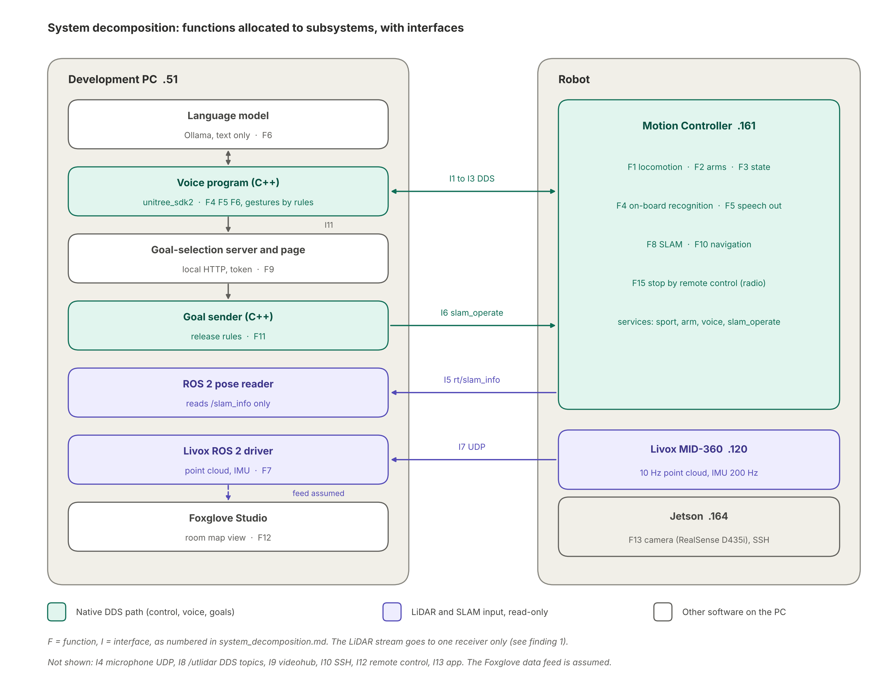

# System decomposition: Unitree G1 EDU with development PC

- **Status:** Draft
- **Date:** 2026-11-18
- **Scope:** Unitree G1 EDU (23 DoF, joints 27 and 28 not fitted) and the software on the development PC. Indoor use, one room, tethered tests.
- **Related:** ADR-0001 to ADR-0004 in [`adr/`](adr/), communication image in [`../docs/G1_communication_paths.png`](../docs/G1_communication_paths.png)

Evidence labels used in all tables:

- **C** = measured or confirmed by source (own measurement, own code, or manufacturer documentation)
- **A** = assumed or unverified

Only public sources and own measurements are used. Measured values carry their date.

## 1 Purpose

This document breaks the system into functions, subsystems and interfaces. It shows where each function runs, how the parts talk to each other, and which statements are proven. It is the input for the risk assessment and the operational FMEA.

## 2 Functions

| ID | Function | Realised by | Evidence |
|---|---|---|---|
| F1 | Locomotion: stand, walk, sit, speed commands | Motion Controller, service `/api/sport` (api_id 7101 mode, 7105 velocity) | C |
| F2 | Arm gestures | Motion Controller, service `/api/arm` | C |
| F3 | State sensing: joints, body IMU, battery | Motion Controller, topic `/lowstate` and others | C |
| F4 | Speech recognition (microphone to text) | On-board recognition on the Motion Controller, topic `rt/audio_msg`; planned replacement by Whisper on the development PC | C (on-board, unreliable for short words, 2026-10-14); A (Whisper, not yet built) |
| F5 | Speech output | Motion Controller, service `/api/voice` | C |
| F6 | Dialogue: text in, text out | Language model (Ollama, qwen3.5:9b) on the development PC, produces text only (ADR-0003) | C |
| F7 | Environment sensing: point cloud, LiDAR IMU | Livox MID-360 with its driver | C |
| F8 | Mapping and localization | Unitree SLAM service `slam_operate` on the Motion Controller | C |
| F9 | Goal selection: sentence or map click to a target pose | Browser page and local server on the development PC | C (text input tested on the robot); A (voice input, deferred) |
| F10 | Navigation: drive to a target pose, pause, stop | `slam_operate` (api_id 1102, 1203) | C |
| F11 | Release rules before every goal (ADR-0004) | Goal sender on the development PC | C (rules implemented); A (thresholds not derived) |
| F12 | Visualization of the room map | Foxglove Studio on the development PC | A (data feed to Foxglove not documented) |
| F13 | Camera image | RealSense D435i on the Jetson, service `videohub` (api_id 1001) | C |
| F14 | Obstacle avoidance | Concept only (staged: LiDAR, depth camera, object camera, fusion) | A (not built; whether `slam_operate` avoids new obstacles was not tested) |
| F15 | Emergency stop | Remote control (L2 + B: damping); stop command 1203 for navigation | C (remote control stop from manufacturer; stop command 1203 answers with an error when no goal runs, 2026-10-07); A (stop effect during a running goal not tested) |
| F16 | Thermal monitoring | Fan state field in `/lf/mainboardstate` | A (field is not filled by the firmware; all six values 0 while the fan ran, 2026-09-07) |

## 3 Subsystems

| Subsystem | Location and address | Role | Evidence |
|---|---|---|---|
| Motion Controller (PC1) | Robot, 192.168.123.161 | Locomotion and arm services, state topics, audio board access, SLAM service, on-board speech recognition | C |
| Jetson Orin NX (PC2) | Robot, 192.168.123.164 | Camera access, Livox driver of the preinstalled runtime, SSH, module fan | C |
| Livox MID-360 | Robot head, 192.168.123.120 | LiDAR, 10 Hz point cloud, 200 Hz IMU, mounted upside down (roll correction) | C |
| RealSense D435i | Robot head, USB to the Jetson | Colour, depth and infrared images; optical axis about 50° downward | C (connection); A (angle estimated, not measured) |
| Motors, joint encoders, IMUs, battery | Robot, internal bus to the Motion Controller | 35 motor slots, 23 fitted; protocol of the internal bus unknown | C (data visible in `/lowstate`); A (bus type) |
| Microphone array and speaker | Robot, audio board | Voice input and output | C |
| Remote control | Radio link to the Motion Controller | Operating state changes, last stop | C (field `wireless_remote` in `/lowstate`, from header) |
| Development PC | 192.168.123.51, wired USB Ethernet, Ubuntu 22.04, RTX 5070 | C++ voice program, language model, goal-selection server and page, ROS 2 pose reader, goal sender, Foxglove | C |
| Mobile app | Wi-Fi to the robot | Operation by Unitree app; not used together with the programming interface | C |

Software on the development PC (own code):

| Program | Task | Interfaces |
|---|---|---|
| Voice program (C++, `unitree_sdk2`) | Recognized text in, language model call, speech output, gestures by fixed rules | DDS to the Motion Controller, local model call |
| Goal-selection server and page | Sentence or click to target pose, confirmation, checks | Local HTTP on 127.0.0.1:8765 with token |
| ROS 2 pose reader | Reads the pose and writes it to a local file | `/slam_info` via ROS 2 |
| Goal sender (C++, `unitree_sdk2`) | Release rules, sends goal, stop, localize | DDS `rt/api/slam_operate/request` |

## 4 Interfaces

| ID | From to | Medium and protocol | Content and rate | Evidence |
|---|---|---|---|---|
| I1 | Development PC to Motion Controller | Ethernet, one segment 192.168.123.0/24, CycloneDDS domain 0, multicast discovery | State topics; `/lowstate` 1041.4 Hz, jitter p99 1.237 ms (2026-09-07, robot hanging, wired). Ping .161 average 0.406 ms, 0 % loss over 200 packets | C |
| I2 | Development PC to Motion Controller | DDS services: request and response topics, api_id plus JSON parameter | `/api/sport`, `/api/arm`, `/api/voice`, `/api/slam_operate` | C |
| I3 | Motion Controller to development PC | DDS topic `rt/audio_msg` | Recognized text | C |
| I4 | Motion Controller to development PC | UDP multicast 239.168.123.161:5555 | Raw microphone signal for Whisper | C (path listed as verified); A (not yet tested with Whisper) |
| I5 | SLAM service to development PC | DDS topic `rt/slam_info` (JSON string), read through ROS 2 as `/slam_info` | Pose, about 1.2 Hz. Gaps up to 8 s while walking (2026-10-15) | C (topic); A (rate from a code comment, gap value from a concept note) |
| I6 | Development PC to SLAM service | DDS service `slam_operate`, api_id 1102 goal, 1203 stop, 1804 localize, 1901 close | Goal limited to 10 m by the manufacturer | C |
| I7 | Livox MID-360 to one receiver | Manufacturer UDP, ports 56300 to 56400 | 10 Hz point cloud, 200 Hz IMU | C |
| I8 | Livox MID-360 to DDS topics `/utlidar/...` | DDS | 10 Hz on 2026-09-07, about 3 Hz on 2026-09-27, no messages at the laptop on 2026-10-07 | C (observations); A (cause) |
| I9 | Jetson to development PC | `videohub` service, one frame per request | 30 to 38 frames per second in continuous requests; access exclusive against the app | C |
| I10 | Development PC to Jetson | SSH, TCP 22 | Login, commands, files | C |
| I11 | Voice program to goal-selection server | Local HTTP POST, token in a user-only file | Recognized navigation sentence | C (from own code) |
| I12 | Remote control to Motion Controller | Radio, proprietary | Button and stick states | C (field from header); A (protocol unknown) |
| I13 | Mobile app to robot | Wi-Fi, TCP services, not DDS | State display, calibration, app navigation | C |

Constraints from the interfaces:

- DDS discovery uses multicast and stops at a router. A routed Wi-Fi network does not work for the development PC (ADR-0001). Wi-Fi latency of 2 to 30 ms (documented estimate) does not fit a 1000 Hz state topic. **A** for the latency range.
- The app navigation and the programming interface must not be used at the same time (manufacturer).
- The camera is accessed exclusively against the app.

## 5 Findings from the decomposition

These points follow from the tables above. They are the inputs for the risk assessment and the FMEA.

1. **Single LiDAR receiver.** The MID-360 sends its UDP stream to one address only (observed: Jetson by default, then the laptop, then broadcast only after a driver run; observed 2026-10-07; "never two receivers at once" is derived, not shown). ADR-0002 routes the stream to the development PC. The built-in SLAM service needs the robot's LiDAR driver service. How SLAM and the direct stream coexist is not documented here. **A**
2. **Safety function is split.** The release rules (F11) run on the development PC before a goal is sent. After a goal is accepted, the robot drives on its own. If the network drops, a running goal continues until the robot stops it itself. Network drops (carrier off) were logged on 2026-10-15. A watchdog on the robot is in the concept, not built. **C** for the drops, **A** for the consequence on a running goal
3. **Pose freshness against pose rate.** The release rule accepts a pose up to 3 s old. The pose arrives at about 1.2 Hz and showed gaps up to 8 s while walking. The rule blocks the start of a goal; it does not monitor a goal that is already running. **C** for the rule, **A** for the rates (see I5)
4. **SLAM service dropouts.** The service stopped answering after saving a map, after aborting a relocalization and after an operating-mode change through the app. A robot restart restored it each time. Cause open. **C** for the observations
5. **One sender of motion.** App and development PC must not send at the same time. No technical lock exists for this. **A**
6. **Thermal state is not observable.** The fan state field stays 0; the fan cannot be read or controlled through DDS. Only the Jetson module fan has a control path (sysfs). **C**
7. **Obstacle handling is open.** A balloon placed in the path was not avoided on 2026-10-07. The manufacturer states that obstacles should be at least 50 cm high and that the robot drives in a straight line. **C**
8. **Voice input is not reliable yet.** The on-board recognition returned the wake word mostly in Japanese script and misrecognized short words (2026-10-14). Voice navigation is deferred until Whisper runs on the development PC. **C**

## 6 Not covered here

- Failure modes and ratings: see the operational FMEA (separate work item).
- Industrialization, maintainability and cost: separate assessment.
- A drawing of this allocation: the existing communication image shows the data paths only.

## Sources

- Own signal registry (128 topics, services, commands, connections, measurements), status 2026-10-14
- Own code: goal sender, pose reader, voice program
- Own notes: LiDAR and SLAM (2026-10-07), obstacle concept (2026-10-15), voice-to-goal (2026-10-14)
- Unitree documentation, SLAM and navigation services interface: https://support.unitree.com/home/en/G1_developer/slam_navigation_services_interface
