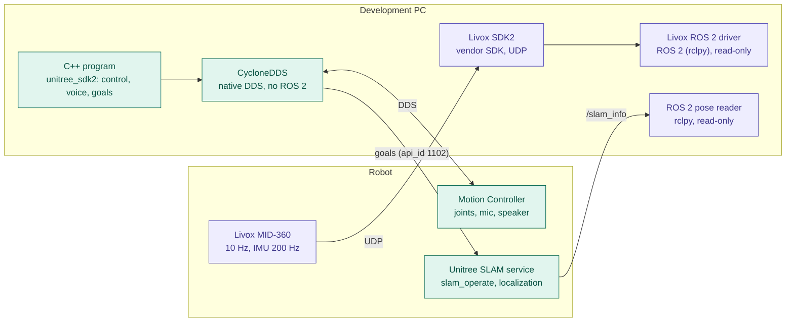

# Communication paths: unitree_sdk2, CycloneDDS and ROS 2

Control, voice and navigation goals run through unitree_sdk2 (C++) and CycloneDDS without ROS 2. ROS 2 is used only as read-only input: the LiDAR point cloud (Livox MID-360 via Livox SDK2 and the Livox ROS 2 driver) and the SLAM pose (see ADR-0001, ADR-0002).

| Colour | Path |
|---|---|
| Green | Native DDS path (control, voice, navigation goals), no ROS 2 |
| Purple | LiDAR and SLAM-pose input, read-only. The Livox SDK2 is the LiDAR vendor's SDK, not unitree_sdk2. |

Status:

- The SLAM service `slam_operate` runs on the Motion Controller (192.168.123.161), observed 2026-10-09 (measured or confirmed by source).
- The pose (`rt/slam_info`) is also a DDS topic. Reading it through unitree_sdk2 instead of ROS 2 is expected to work but was not tried (assumed or unverified).
