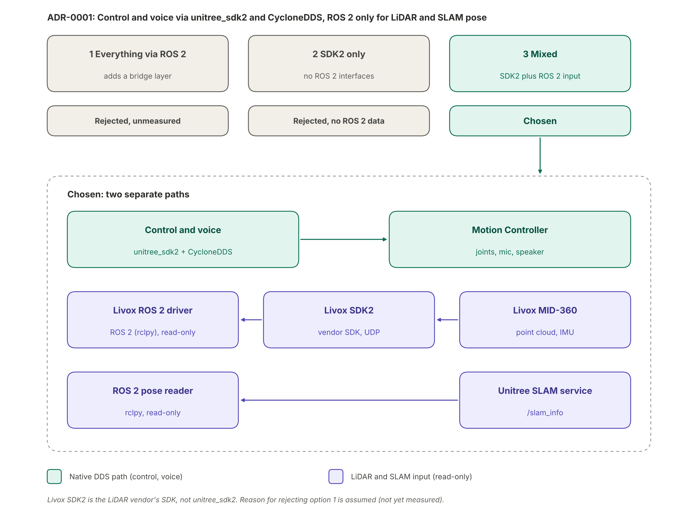

# ADR-0001: Control and voice via unitree_sdk2 (C++) and CycloneDDS, ROS 2 only for LiDAR and SLAM pose

- **Status:** Draft
- **Date:** 2026-11-06
- **Scope:** Unitree G1 EDU, development PC <-> Motion Controller

## Context

The G1 exposes its state and control interfaces as DDS topics. The project needs one communication path for low-latency control, voice dialogue (recognized text in, speech output out) and arm gestures, with interfaces that can be documented and measured topic by topic (128 DDS topics are documented in the signal registry).

Two constraints shape the decision:

- DDS discovery needs a direct connection within the same network segment (192.168.123.0/24). Over a routed Wi-Fi network the development PC cannot discover the Motion Controller.
- The Livox driver is a ROS 2 interface. The Unitree SLAM service (`slam_operate`, running on the Motion Controller) publishes its pose as the DDS topic `rt/slam_info` (JSON string). The project reads it through ROS 2 (`/slam_info`); the same topic is also a DDS topic and could be read with unitree_sdk2.

## Options considered

1. **Everything through ROS 2.** One middleware for all data. Adds a bridge layer between ROS 2 and the robot's native DDS interface for control and voice.
2. **unitree_sdk2 (C++) with CycloneDDS, no ROS 2.** Talks to the robot's native DDS interfaces directly.
3. **Mixed (chosen).** Option 2 for control, voice and SLAM commands; ROS 2 (rclpy) only for read-only input: the Livox driver and the SLAM pose reader.

## Decision

Control and voice run through unitree_sdk2 (C++) and CycloneDDS without ROS 2. ROS 2 is used only for the Livox LiDAR driver (which runs on the Livox SDK2, see ADR-0002) and for reading the SLAM pose. Navigation goals and other SLAM commands (api_id 1102 and others) are sent with unitree_sdk2 to the `slam_operate` service over DDS, not through ROS 2.

## Consequences

- Control and voice code stays on the robot's native interface; the documented topics map one-to-one to the signal registry.
- Two communication stacks are in use. Their boundary must stay explicit: ROS 2 data is read-only input (point cloud, pose); it does not issue motion commands.
- The CycloneDDS configuration (network interface selection) becomes a commissioning item and is kept in the repository (`examples/cyclonedds_g1.xml`).
- Network placement matters: the development PC must be in the robot's L2 segment, wired or via the mobile router (GL.iNet Mudi 7).

## Evidence

| Statement | Status |
|---|---|
| 128 DDS topics documented in the signal registry | measured or confirmed by source |
| DDS discovery fails over routed Wi-Fi, works in the same L2 segment | measured or confirmed by source |
| Livox driver and `/slam_info` are accessed via ROS 2 | measured or confirmed by source |
| Navigation goals (api_id 1102) are sent with unitree_sdk2 to `rt/api/slam_operate/request` | measured or confirmed by source (own code `slam_ziel.cpp`) |
| SLAM service and the `rt/slam_info` publisher run on the Motion Controller (.161) | measured or confirmed by source (measured 2026-10-09) |
| SLAM pose could also be read with unitree_sdk2 instead of ROS 2 | assumed or unverified: it is a DDS topic, but no SDK2 subscriber was tried |
| Reasons for rejecting option 1 (bridge overhead, latency) | assumed or unverified: no comparison measurement yet |
