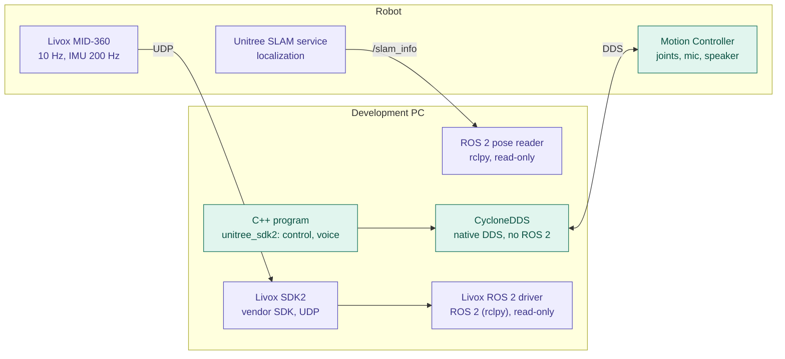

# Communication paths: unitree_sdk2, CycloneDDS and ROS 2

Control and voice run through unitree_sdk2 (C++) and CycloneDDS without ROS 2. ROS 2 is used only as read-only input: the LiDAR point cloud (Livox MID-360 via Livox SDK2 and the Livox ROS 2 driver) and the SLAM pose (see ADR-0001, ADR-0002).

| Colour | Path |
|---|---|
| Green | Native DDS path (control, voice), no ROS 2 |
| Purple | LiDAR and SLAM input, read-only. The Livox SDK2 is the LiDAR vendor's SDK, not unitree_sdk2. |

Status: where the SLAM service runs on the robot is not documented here (assumed or unverified).
