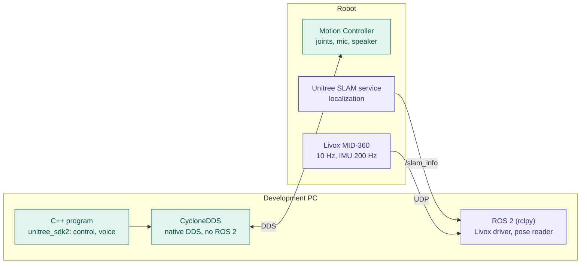

# Communication paths: unitree_sdk2, CycloneDDS and ROS 2

Control and voice run through unitree_sdk2 (C++) and CycloneDDS without ROS 2. ROS 2 is used only as read-only input for the LiDAR point cloud and the SLAM pose (see ADR-0001, ADR-0002).

| Colour | Path |
|---|---|
| Green | Native DDS path (control, voice), no ROS 2 |
| Purple | ROS 2 path, read-only input (point cloud, pose) |

Status: where the SLAM service runs on the robot is not documented here (assumed or unverified).
