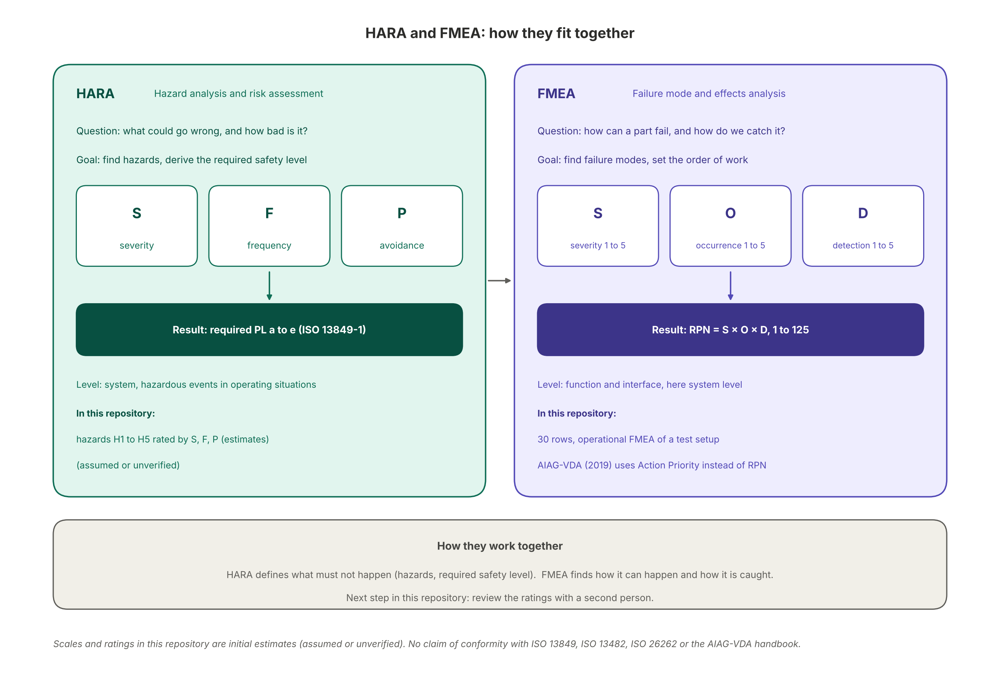
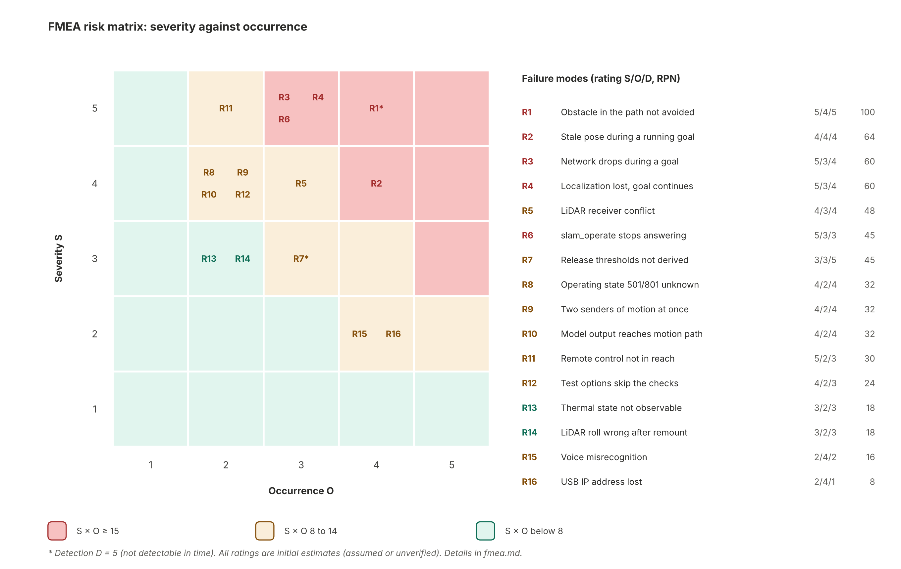

# Operational FMEA: voice and navigation on the Unitree G1 EDU

- **Status:** Draft, ratings to be reviewed
- **Date:** 2026-11-19
- **Scope:** Goal-based navigation, voice dialogue and the release rules around them (ADR-0003, ADR-0004). Indoor use, one room, tethered tests.
- **Input:** [`system_decomposition.md`](system_decomposition.md) (functions F1 to F16, interfaces I1 to I13, findings 1 to 8)

## 1 Concepts and method

### 1.1 Terms

| Term | What it is | Guiding question | Result | Use here |
|---|---|---|---|---|
| **HARA** (hazard analysis and risk assessment) | Method to find hazards and rate them. The term comes from ISO 26262-3; for machinery the same step is the risk assessment of ISO 12100 | What could go wrong, and how bad is it? | Hazards rated by S, F and P, giving a required performance level (PLr) | Hazards H1 to H5 are defined and rated in section 2 (estimates) |
| **FMEA** (failure mode and effects analysis) | Method to find failure modes of parts and functions and to order them | How can a part fail, and how do we catch it? | Table with failure mode, effect, cause, S/O/D, priority, action | This document, 30 rows |
| **HAZOP** (hazard and operability study) | Method from process engineering: search systematically for deviations from the intended operation | What happens if something deviates from the intent? | List of deviations with cause and consequence | Not used as a whole; only its guide words |
| **Guide words** | Fixed key words with which every function is questioned (from HAZOP) | Four questions (section 1.4) | Candidates for failure modes | Applied to every relevant function |
| **Guide-word walk** | Going through all functions, one by one, with the guide words | What follows if function X fails, comes too late, gives a wrong value or acts unintended? | Rows R17 to R30 | Done by reasoning; the full function-by-guide-word matrix is not yet documented |
| **PL / PLr** (performance level, required) | Result of the risk graph in ISO 13849-1, levels a to e | – | Defines how reliable a safety function must be | Not assigned yet |
| **ASIL** (automotive safety integrity level) | Result of the HARA in ISO 26262, levels A to D, or QM | – | Same idea for road vehicles | Reference only; table in [`safety_standards_overview.md`](safety_standards_overview.md) |
| **RPN** (risk priority number) | Product S × O × D | – | Sorting of failure modes | Used here for sorting only |
| **Action Priority (AP)** | Replaces the RPN in the AIAG-VDA FMEA handbook (2019) | – | Priority high, medium or low by rule | Not used here |

### 1.2 Order of work

| Step | Method | Result |
|---|---|---|
| 1 | Risk assessment (HARA pattern, ISO 12100) | Hazards H1 to H5 (section 2) |
| 2 | Allocation | Which function can contribute to which hazard (section 3). Functions without a link are excluded with a reason |
| 3 | Guide-word walk | Failure modes per relevant function |
| 4 | FMEA | Rating by S, O, D, priority and actions (section 4) |
| 5 | Tests and measurements | Assumptions become confirmed statements |

The HARA says what must not happen. The guide words find how it can happen. The FMEA orders what is fixed first. Completeness cannot be proven. The claim is limited to this scope, this method and the listed exclusions.

### 1.3 Rating of hazards: S, F, P and required performance level

The G1 is a machine. The pattern for rating a hazard therefore follows ISO 12100 (risk assessment) and the risk graph of ISO 13849-1. ISO 26262 (road vehicles, S/E/C and ASIL) and SORA (drones) are compared in [`safety_standards_overview.md`](safety_standards_overview.md). No required performance level is assigned in this repository yet.

| Parameter | Question | Levels |
|---|---|---|
| **S** severity | How severe is the injury? | S1 slight (normally reversible). S2 serious (normally irreversible, or death) |
| **F** frequency / exposure | How often and how long is a person exposed to the hazard? | F1 seldom to less often and/or short exposure. F2 frequent to continuous and/or long exposure |
| **P** possibility of avoidance | Can the person avoid the hazard or limit the harm? | P1 possible under specific conditions. P2 scarcely possible |

| S | F | P | PLr |
|---|---|---|---|
| S1 | F1 | P1 | a |
| S1 | F1 | P2 | b |
| S1 | F2 | P1 | b |
| S1 | F2 | P2 | c |
| S2 | F1 | P1 | c |
| S2 | F1 | P2 | d |
| S2 | F2 | P1 | d |
| S2 | F2 | P2 | e |

Low risk gives PL a, high risk gives PL e. The PLr belongs to a safety function (sensor, logic, actuator), not to a single component. Only the rows S2/F2/P2, S2/F2/P1 and S2/F1/P2 are confirmed by a public source; the other rows are plausible but not confirmed by the standard (details in the overview).

### 1.4 Guide words

| Guide word | Question to the function |
|---|---|
| fails | What happens if it is missing? |
| too late | What happens if it comes too late? |
| wrong value | What happens if it delivers something wrong? |
| unintended | What happens if it acts without cause? |

### 1.5 FMEA scales of this repository

This is an operational FMEA for prioritizing work on a test setup. It is **not** a hazard analysis and **not** a safety case. No PLr, no ASIL, no safety goals, no claim of conformity with ISO 13849, ISO 13482, ISO 26262, the AIAG-VDA handbook or any other standard.

Scales, 1 to 5:

| Rating | 1 | 3 | 5 |
|---|---|---|---|
| **S** severity | no effect on motion | robot stops or leaves the path | fall or collision with a person or object |
| **O** occurrence | not seen, hard to imagine | seen once in the logs | seen repeatedly |
| **D** detection | detected before motion, automatic | detected during motion by the operator | not detectable in time |

RPN = S × O × D (maximum 125). The AIAG-VDA handbook replaces the RPN by the Action Priority; here the RPN only sorts the work for a test setup. The ratings are initial estimates (**assumed or unverified**). They set the order of work, not a verdict. The column "Cause and evidence" separates observed facts (**C** = measured or confirmed by source) from assumptions (**A**).

### 1.6 Origin of the rows

R1 to R16 come from own tests, logs and code. R17 to R30 come from the guide-word walk. For several of these rows an observation exists in the column "Cause and evidence" (marked **C**); for the others the cause is an assumption (**A**). A comparison of the test log with the table shows test findings that have no row of their own; they are listed in section 6.

## 2 Hazards and rating

| ID | Hazard | S | F | P | PLr | Reason |
|---|---|---|---|---|---|---|
| H1 | Uncontrolled drive (wrong goal, wrong direction, drive without supervision) | S2 | F1 | P1 | c | A walking humanoid can seriously injure a person in a collision (assumed). Room cleared and operator at a distance in the tests (F1). The remote control stop is in hand (P1); the stopping delay is not measured |
| H2 | Collision with a person or object | S2 | F1 | P1 | c | Same basis as H1. Obstacles lower than 50 cm are not avoided (R1) |
| H3 | Fall | S2 | F1 | P1 | c | A falling robot can injure a person nearby (assumed). Tethered tests. A person can step away when the distance is kept |
| H4 | Stop not possible | S2 | F1 | P2 | d | Without a stop, a person can hardly avoid H1 and H2 (P2). The stop function (remote control and stop command) carries this level |
| H5 | Unintended gesture or arm movement | S1 | F2 | P1 | b | Gestures are made near persons by design (F2). Injury through the arm assumed slight (S1) |

S, F and P are initial estimates (**assumed or unverified**). If the remote control is not in hand, P1 becomes P2 and the level for H1 to H3 rises to d. A PLr belongs to a safety function, not to a hazard; in practice the level of H4 applies to the stop function. In the risk graph (section 1.3) only the row S2/F1/P2 (H4) is confirmed by a public source; the rows S2/F1/P1 (H1 to H3) and S1/F2/P1 (H5) are plausible but not confirmed.

## 3 Allocation of functions to hazards

| Function | Relevant for | Rows |
|---|---|---|
| F1 Locomotion | H1, H3 | R8, R27 |
| F2 Arm gestures | H5 | R25, R26 |
| F3 State sensing | H3 | R29 |
| F4 Speech recognition | H1 | R15 |
| F6 Dialogue (language model) | H5 | R10, R24 |
| F7 Environment sensing (LiDAR) | H1, H2 | R5, R14, R20, R21 |
| F8 Mapping and localization | H1, H4 | R2, R4, R6, R19 |
| F9 Goal selection | H1 | R22, R23 |
| F10 Navigation | H1, H4 | R3, R9, R17, R18 |
| F11 Release rules | H1 | R7, R12 |
| F14 Obstacle avoidance | H2, H3 | R1, R28 |
| F15 Emergency stop | H4 | R11 |
| F16 Thermal monitoring | H3 | R13 |
| Power supply (not in the function list of the decomposition) | H3 | R30 |
| I1 Network | H1 | R16 |

Excluded with reason:

- **F5 Speech output:** no link to H1 to H5.
- **F12 Visualization (Foxglove):** display only.
- **F13 Camera image:** display only, until the camera feeds the obstacle avoidance.

## 4 FMEA table, sorted by RPN

| ID | H | Failure mode (function, guide word) | Effect | Cause and evidence | Existing control | S/O/D | RPN | Action |
|---|---|---|---|---|---|---|---|---|
| R1 | H2 | Obstacle in the path is not avoided (F14) | Collision with furniture, object or person; possible fall | The robot drives in a straight line. A balloon was not avoided (2026-10-07). On 2026-10-13 the left shoulder caught an obstacle on the way to the door although the route check reported the path free (no point closer than 0.30 m to the centre line); the robot stopped and walked on by itself after a few seconds. Obstacles must be at least 50 cm high (manufacturer). **C**. Whether `slam_operate` avoids new obstacles was not tested. **A** | Dry run by default, confirmation, remote control in hand, tethered tests | 5/4/5 | 100 | Build stage 0 and 1 of the obstacle concept (watchdog, LiDAR stop zone). Until then: tethered tests, clear room, test whether `slam_operate` stops for obstacles |
| R2 | H1 | Pose is stale during a running goal (F8, I5) | Robot steers on a wrong position | Pose gaps up to 8 s while walking (2026-10-15) and over 10 s in the stand (2026-10-14). Release rule checks pose age only at the start. **C** | 3 s pose age rule at start | 4/4/4 | 64 | Watchdog that stops on pose age during the run (concept stage 0). Measure the real pose rate and gaps |
| R3 | H1 | Network drops while a goal runs (I1, I6) | Robot continues to the goal without supervision | Carrier off events logged (2026-10-15). **C**. Behaviour of a running goal without the sender is not tested. **A** | Remote control stop, tethered tests | 5/3/4 | 60 | Watchdog on the Jetson that sends a stop when pose, LiDAR or network are missing. Test: unplug the cable during a goal, with tether |
| R4 | H1 | Localization is lost, robot keeps its goal (F8) | Robot drives with a wrong map position | Localization was lost during a turn (2026-10-15), after a pause with zero torque and hanging (2026-10-13), and after standing up (jump to another position, then no pose for over 200 s, 2026-10-14). Command 1804 alone did not help; 1901 followed by 1804 restored it. **C**. The read-only status command 1936 exists but is not part of the release rules. **C** | Pose age rule (does not detect wrong poses) | 5/3/4 | 60 | Check the relocalization status (1936) before every goal and during the run |
| R5 | H1 | LiDAR stream conflict between development PC and robot (F7, F8, I7) | Built-in SLAM loses its LiDAR data, localization fails | Stream goes to one receiver only; it stayed at the laptop until a robot restart (2026-10-07). **C**. Effect on the built-in SLAM while the PC receives: **A** | Check the pose before a goal | 4/3/4 | 48 | Decide one receiver per operating mode and write it down. Test: pose and navigation with the development PC driver running |
| R17 | H1 | Stop acts too late (F10, too late) | Robot travels on after the stop command | Delay and stopping distance after a stop command were not measured. **A**. Stop 1203 answers with an error when no goal runs (2026-10-07). **C** | Remote control stop, tethered tests | 4/3/4 | 48 | Measure the delay from stop command to standstill, with tether |
| R18 | H1 | Goal taken from an outdated map (F10, wrong value) | Goal inside furniture or a person's space; robot drives into it | Default map file dates from 2026-10-08. The path check uses the stored map only (concept note 2026-10-15). **C**. Room changes after the scan: **A** | Dry run, confirmation, straight-line check against the stored map | 4/3/4 | 48 | Show map age in the goal page; rescan after furniture changes |
| R6 | H4 | `slam_operate` stops answering (F8, F10) | No goals, and no stop through the same service (1203) | Service did not answer after saving a map, after aborting a relocalization and after an app mode change; restart fixed it (2026-10). **C**. Cause open | Reply timeout of 8 s in the sender | 5/3/3 | 45 | Second stop path through `/api/sport` (velocity zero, `StopMove`) in the sender. Find the cause of the dropouts |
| R7 | H1 | Thresholds of the release rules are wrong (F11) | Rules too loose (unsafe goal accepted) or too tight (goal blocked) | 3 s and 3 m were set by judgement, not derived. **A** (ADR-0004) | Rules active, test limit 3 m | 3/3/5 | 45 | Derive the thresholds from the measured pose rate and the stopping behaviour; document in ADR-0004 |
| R20 | H2 | No LiDAR points (F7, fails) | No obstacle data and SLAM falls out; robot may continue until the pose is stale | On 2026-10-07 the LiDAR topics had a publisher but no messages at the laptop. **C**. Concept: without LiDAR no safe drive. **A** | Pose age rule (indirect) | 5/3/3 | 45 | Watchdog: LiDAR older than 0.5 s means stop (concept stage 0) |
| R28 | H3 | Edge or step not detected (F14, wrong value) | Fall at a step or edge | Only the depth camera sees edges; the camera looks down at about 50° (estimated) and is not used for navigation yet. **A** | Known paths only, indoor room without steps | 5/2/4 | 40 | Exclude stairs from the scope; build depth stage 2 of the obstacle concept |
| R8 | H1 | Operating state 501 or 801 behaves differently from 500 (F1, F11) | Unexpected speed or gait in an accepted state | Header file lists 500, 501 and 801 as states that accept motion commands. Meaning of 501 and 801 is not documented. **C** for the list, **A** for the behaviour | Rule accepts all three | 4/2/4 | 32 | Test 801 with the remote control; restrict the rule to 500 until proven |
| R9 | H4 | Two senders of motion at once (F10) | Conflicting commands from the app and the development PC | Manufacturer: do not use app navigation and the interface together. **C**. No technical lock. **A** | Operating rule | 4/2/4 | 32 | Add a check in the sender (is another sender active) or a visible interlock in the page |
| R10 | H5 | Model output reaches the motion path (F6, F9) | Unintended motion from free text | Design: model produces text, motion decided by fixed logic (ADR-0003). No code-level proof. **A** | Fixed rules, confirmation click | 4/2/4 | 32 | Code review or test showing that only the rule logic can trigger gestures and goals |
| R21 | H2 | Glass and mirrors not detected (F7, wrong value) | Robot drives into a glass door or pane | The room has a frosted-glass door (map). **C**. LiDAR and depth camera often miss glass (concept note). **A** | Operator watches, tethered tests | 4/2/4 | 32 | Mark glass as a no-go zone in the map |
| R11 | H4 | Remote control not within reach or radio link lost (F15) | The last stop is missing | Remote control is the last stop. **C** (manufacturer). Link behaviour not tested. **A** | The goal sender asks for confirmation that the remote control is in hand | 5/2/3 | 30 | Add the remote control check to the commissioning checklist |
| R12 | H1 | Release rules skipped by test options (F11) | Goal sent with a stale pose or in a wrong operating state | `--ohne-pose` and `--ohne-zustand` skip two checks in the command-line tool. **C** | Options named in the help text, distance limit stays active | 4/2/3 | 24 | Remove the options from the default build or require a separate confirmation |
| R19 | H1 | Wrong map loaded (F8, wrong value) | Localization in the wrong map, goals in the wrong place | The sender has one fixed default map path; several maps exist on the robot. **C**. Map name is part of the pose message. **C** | Relocalization status (1936) can be read | 4/2/3 | 24 | Compare the map name in the pose with the expected map before every goal |
| R29 | H3 | IMU or joint data wrong (F3, wrong value) | Wrong state used by the sender or the operator | Whether `imu_state` holds the body or the crotch IMU is open (signal registry). **A** | Several state sources (`/lowstate`, `/secondary_imu`) | 3/2/4 | 24 | Settle the IMU assignment by comparing pitch with the app |
| R30 | H3 | Battery empty or voltage drop in operation (Power, fails) | Shutdown or collapse | Charge fell from 100 % to 68 % in one measurement series and 34 % at the end of the session (2026-09-07, hanging). **C**. Battery data is visible in `/lf/bmsstate`. **C** | Battery data visible, no limit in the sender | 4/3/2 | 24 | Add a battery level to the release rules; value to be defined |
| R13 | H3 | Thermal state not observable (F16) | Overheating is not noticed | Fan state field stays 0 while the fan runs. **C**. Motor temperature is visible in `/lowstate`. **C** | Motor temperature telemetry | 3/2/3 | 18 | Add a temperature limit to the watchdog |
| R14 | H1 | LiDAR roll correction is wrong after remounting (F7) | Wrong map and pose | Mounted upside down, corrected in the driver (ADR-0002). **C** | IMU gravity check | 3/2/3 | 18 | Add the gravity check to the commissioning checklist |
| R22 | H1 | Sentence resolved to the wrong object or side (F9, wrong value) | Wrong target proposed | Rules map a sentence to object and side; the page asks for the side when missing. **C**. Other wrong resolutions: **A** | Target shown on the map, goal only after "Losgehen" and confirmation | 3/3/2 | 18 | Show the resolved target name in the confirmation dialog |
| R25 | H5 | Gesture in the wrong state (F2, unintended) | Arm moves while walking or hanging | Allowed states for gestures are not documented. **A** | Gestures only by fixed rules (ADR-0003) | 3/2/3 | 18 | Check the operating state (fsm_id) before every gesture |
| R26 | H5 | Arm hits a person or object (F2, wrong value) | Contact with a person or object during a gesture | Gestures run from a fixed action list; no clearance check. **A** | Operating rule: free space around the robot | 3/2/3 | 18 | Gesture only with free space; test each gesture tethered |
| R15 | H1 | Wrong or missing voice recognition (F4) | Wrong target proposed, or no reaction | On-board recognition returned the wake word in Japanese script and "coach" for "couch" (2026-10-14). **C** | Page shows the target; goal only after "Losgehen" and confirmation | 2/4/2 | 16 | Whisper on the development PC (planned) |
| R27 | H3 | Mode change to damping while walking (F1, unintended) | Robot sinks or falls | Damping from walk makes the robot collapse (own state overview). **C**. The goal page blocks damping and zero torque while the robot moves (code). **C** | Page block, tether | 4/2/2 | 16 | Keep the block in every sender; add to the commissioning checklist |
| R23 | H1 | Foreign speaker or TV triggers a goal (F9, unintended) | Goal proposed without the operator asking | Wake word "Rocky" in the first three words, then a 12 s window; any voice is accepted. **A** | Goal only after click and confirmation | 3/2/2 | 12 | Keep the click confirmation; no voice confirmation without a speaker check |
| R24 | H5 | Language model does not answer (F6, too late) | Robot stays silent or waits; no motion | No answer after 60 s with GPU load 0 % (2026-10-14). **C** | None documented | 2/3/2 | 12 | Timeout with a fallback phrase; check `ollama ps` at start |
| R16 | H1 | IP address of the USB Ethernet interface is lost (I1) | No state, no commands | The address is lost regularly (project note). **C** | Sender rejects the goal when the service is not reachable; network check before each session | 2/4/1 | 8 | Persistent address configuration |

## 5 What the table says

1. The top four rows (R1 to R4) share one cause: nothing supervises a goal after it started. The release rules act only before the start.
2. One watchdog on the robot (pose, LiDAR, network, temperature, battery, stop through `/api/sport`) lowers R1 to R4, R6, R13, R20 and R30 together. It is the largest single measure.
3. R5 and R6 depend on facts that are not yet measured. Two tests settle them: navigation with the development PC LiDAR driver running, and a goal with the network cable unplugged (with tether).
4. R17 needs a measurement of the stopping delay and distance. Without it, no stop rule can be justified.

## 6 Not covered

- Test findings without a row of their own: a turn before the drive and at the goal; a goal reached about 10 cm off; foreign points in the map (traces of persons, an open drawer) that must be removed before use; load on the Jetson (`teleimager`, camera dropouts); truncated microphone packets (receive buffer smaller than 5120 bytes); several pose readers at the same time; latency over Wi-Fi (only the wired baseline is measured).
- Hazards to people from the robot itself beyond H1 to H5 (pinch points, stored energy): needs its own hazard analysis.
- Cybersecurity of the local server, tokens and network.
- Hardware failures inside the robot.
- Ratings were not reviewed by a second person.

## Sources

- [`safety_standards_overview.md`](safety_standards_overview.md) for the standards named in section 1
- [`system_decomposition.md`](system_decomposition.md) and the ADRs in [`adr/`](adr/)
- Own signal registry, own code, own notes on LiDAR and SLAM (2026-10-07), obstacle concept (2026-10-15), voice-to-goal (2026-10-14), operating-state overview
- Unitree documentation, SLAM and navigation services interface: https://support.unitree.com/home/en/G1_developer/slam_navigation_services_interface
